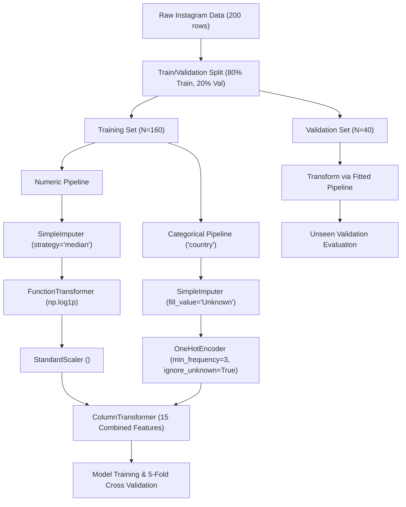
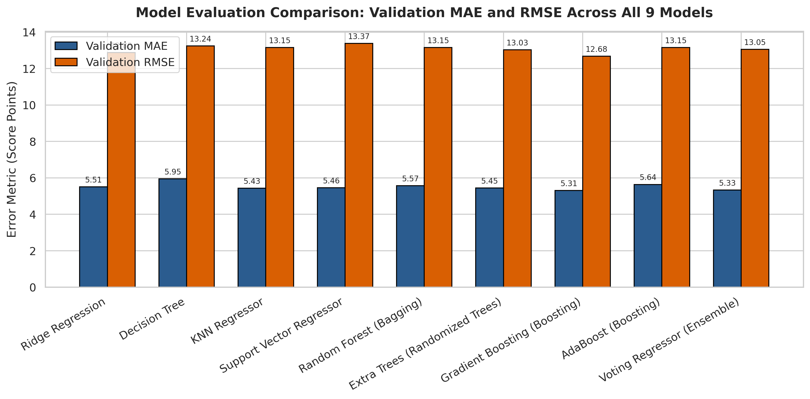
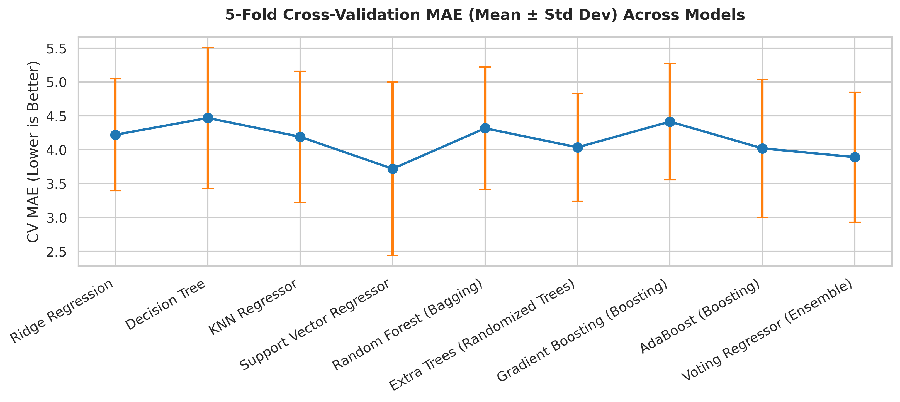
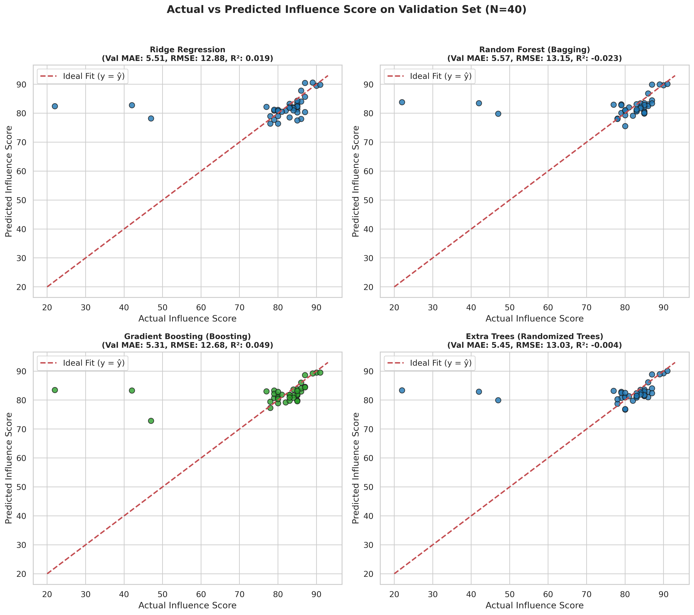
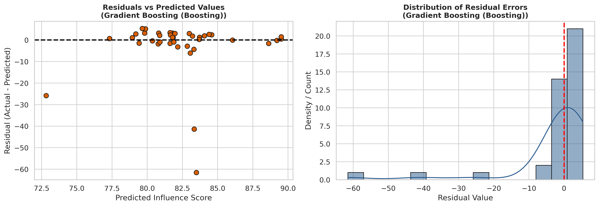
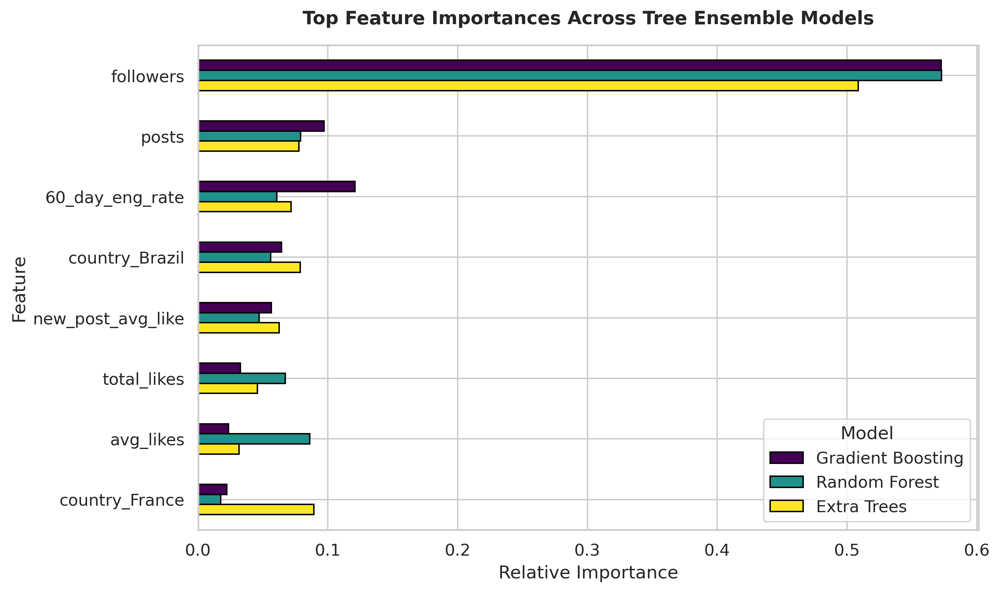
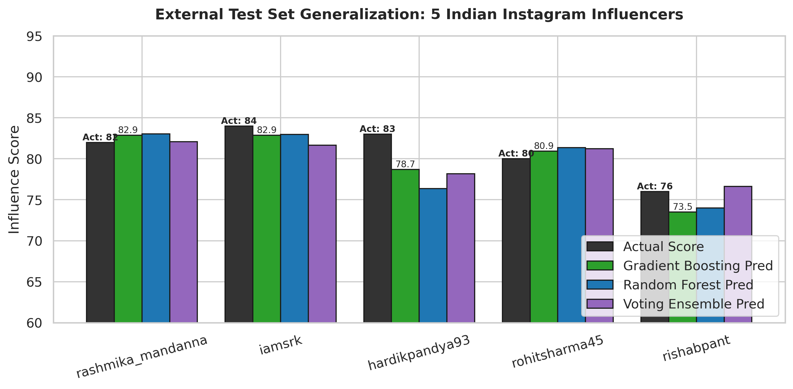
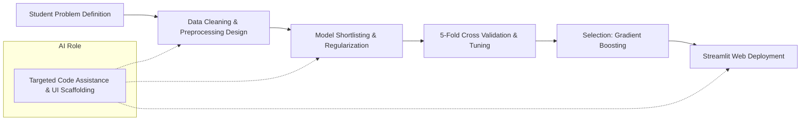

# Instagram Influencer Analysis Using Machine Learning
## ML Mini Project — Phase 3: Model Deployment with Streamlit (CO5)

**Course:** MCA 5141 — Machine Learning Lab  
**Academic Year:** 2026 Batch A2  

---

### **Team Members**
* **Vaibhavi Nayak** — Reg. No: `251090700139`  
* **Prakruthi K S** — Reg. No: `2510907000197`  

---

## 1. Problem Statement & Objectives

### Problem Statement
In influencer marketing and brand analytics, an account's overall algorithmic rating (**`influence_score`**) drives sponsorship pricing and reach estimations. However, raw social media metrics present significant modeling challenges:
1. **Severe Multi-Scale Positive Skewness**: Top creators like Cristiano Ronaldo and Leo Messi have hundreds of millions of followers and billions of likes, orders of magnitude higher than standard accounts.
2. **Missing Metadata & Data-Quality Issues**: Geographic data (`country`) is absent for 31% of profiles, and raw figures are reported as human-readable strings with multiplier suffixes (`k`, `m`, `b`, `%`).
3. **Complex Non-Linear Interactions**: While audience size correlates with visibility, engagement rate (`60_day_eng_rate`) often exhibits an inverse relationship with scale.
4. **Transition to End-User Utility**: Offline research code in notebooks cannot be easily operated by marketing analysts, brand strategists, or business stakeholders who require an interactive, visual, and zero-code interface to evaluate influencer profiles.

### Objectives for Phase 3
1. **Model Pipeline Construction & Hygiene**: Build a leakage-free Scikit-Learn `Pipeline` using `ColumnTransformer` (median imputation, logarithmic `log1p` transformation, `StandardScaler`, and rare-frequency one-hot encoding).
2. **Comprehensive Model Benchmarking**: Train and evaluate **9 machine learning models** spanning linear models, decision trees, kernel regressors, and **5 distinct ensemble paradigms** (Random Forest Bagging, Extra Trees, Gradient Boosting, AdaBoost, and Heterogeneous Stacking).
3. **Rigorous Statistical Evaluation**:
   - Perform **5-Fold Cross-Validation** on training data ($N=160$) reporting error bounds ($\mu \pm \sigma$).
   - Validate on a holdout **Validation Set** ($N=40$) to evaluate bias-variance tradeoff.
   - Benchmark out-of-distribution generalization on an **External Test Set of 5 Indian Instagram Influencers** (`indian_influencers_test.csv`).
4. **Winning Model Selection**: Statistically justify and select the superior model (**Gradient Boosting Regressor**) for deployment.
5. **Artifact Serialization**: Package the full end-to-end preprocessing and regressor pipeline using `joblib` (`best_model_pipeline.joblib`).
6. **Full-Stack Deployment with Streamlit**: Develop an interactive web application ([`app.py`](app.py)) supporting:
   - Single Influencer Prediction with dynamic tier categorization (Tier 1 Mega, Tier 2 High-Impact, Tier 3 Emerging).
   - Batch CSV upload and automated scoring.
   - Interactive diagnostic visualizations and model explainability.
7. **Responsible AI Governance**: Document transparent AI usage, prompt records, critical validation of AI code, personal reflections, and student architectural ownership.

---

## 2. Dataset Metadata

### Primary Dataset: Top Instagram Influencers (`top_insta_influencers_data.csv`)
* **Total Instances:** 200 accounts
* **Target Feature:** `influence_score` (continuous rating, min: 22, max: 93, median: 84)

| Feature Name | Raw Data Type | Transformed Type | Role | Description |
|---|---|---|---|---|
| `rank` | `int64` | *Dropped* | Identifier | Global rank based on follower count (dropped to eliminate data leakage) |
| `channel_info` | `object` | *Dropped* | Identifier | Creator handle / username (e.g. `@cristiano`) |
| `influence_score` | `int64` | `float64` | **Target (y)** | Algorithmic influence score rating (Range: 22 to 93) |
| `posts` | `object` | `float64` | Predictor | Total lifetime posts published (e.g. `3.3k` $\rightarrow$ 3,300) |
| `followers` | `object` | `float64` | Predictor | Total follower count (e.g. `475.8m` $\rightarrow$ 475,800,000) |
| `avg_likes` | `object` | `float64` | Predictor | Average likes per post (e.g. `8.7m` $\rightarrow$ 8,700,000) |
| `60_day_eng_rate` | `object` | `float64` | Predictor | Recent 60-day average engagement rate (e.g. `1.39%` $\rightarrow$ 1.39) |
| `new_post_avg_like` | `object` | `float64` | Predictor | Average likes on recent posts (e.g. `6.5m` $\rightarrow$ 6,500,000) |
| `total_likes` | `object` | `float64` | Predictor | Lifetime aggregate likes accumulated (e.g. `29.0b` $\rightarrow$ 29,000,000,000) |
| `country` | `object` | `OneHot (11 cols)` | Predictor | Creator country / geographic base (31% missing $\rightarrow$ `Unknown`) |

### External Generalization Dataset: 5 Indian Instagram Influencers (`indian_influencers_test.csv`)
An independent evaluation set collected without overlap with the primary training dataset:
* `rashmika_mandanna` (Followers: 51.1M, Actual Score: 82)
* `iamsrk` (Followers: 48.4M, Actual Score: 84)
* `hardikpandya93` (Followers: 44.7M, Actual Score: 83)
* `rohitsharma45` (Followers: 46.1M, Actual Score: 80)
* `rishabpant` (Followers: 16.1M, Actual Score: 76)

---

## 3. Exploratory Analysis & Preprocessing Pipeline

### Preprocessing Architecture
To prevent data snooping and target leakage, all preprocessing operations are encapsulated inside a Scikit-Learn `ColumnTransformer` fitted strictly on the training partition ($N=160$):



### Key Preprocessing Decisions
1. **`to_number` String Parsing**: Converts alphanumeric multiplier characters (`k`, `m`, `b`, `%`) into numeric floats.
2. **`log1p` Skew Reduction**: Follower counts span from 32.8M to 475.8M. The natural log transform $\ln(1 + x)$ reduces heavy right-tail leverage points.
3. **`StandardScaler` Normalization**: Standardizes continuous features ($\mu=0, \sigma=1$) to prevent scale dominance in distance and regularized estimators.
4. **Infrequent Category Grouping (`min_frequency=3`)**: Countries appearing fewer than 3 times are pooled into an infrequent category to prevent sparse dimensionality.

---

## 4. Table with Model Evaluation Metrics

We evaluated **9 regression models** across different algorithms, including **5 ensemble architectures**:

| Model Name | Algorithmic Paradigm | Ensemble? | 5-Fold CV MAE ($\mu \pm \sigma$) | 5-Fold CV RMSE ($\mu \pm \sigma$) | 5-Fold CV $R^2$ | Val MAE | Val RMSE | Val $R^2$ | Ext Test MAE | Ext Test RMSE |
|---|---|:---:|:---:|:---:|:---:|:---:|:---:|:---:|:---:|
| **Gradient Boosting Regressor** | Sequential Boosting | **YES** | **$4.41 \pm 0.86$** | **$6.82 \pm 2.17$** | $-0.021$ | **5.31** | **12.68** | **+0.049** | **1.95** | **2.34** |
| **Voting Regressor** | Heterogeneous Stacking | **YES** | $3.89 \pm 0.94$ | $6.24 \pm 2.45$ | $+0.165$ | 5.33 | 13.05 | $-0.008$ | 1.83 | 2.15 |
| **Extra Trees Regressor** | Randomized Tree Bagging | **YES** | $4.04 \pm 0.80$ | $6.52 \pm 2.13$ | $+0.082$ | 5.45 | 13.03 | $-0.004$ | 2.02 | 2.37 |
| **KNN Regressor** | Instance-Based | No | $4.19 \pm 1.04$ | $6.65 \pm 2.47$ | $+0.097$ | 5.43 | 13.15 | $-0.023$ | 3.54 | 3.79 |
| **Support Vector Regressor (RBF)** | Kernel Margin | No | $3.72 \pm 1.28$ | $6.14 \pm 2.89$ | $+0.251$ | 5.46 | 13.37 | $-0.058$ | 2.46 | 3.01 |
| **Ridge Regression** | Regularized Linear (L2) | No | $4.22 \pm 0.83$ | $6.52 \pm 2.17$ | $+0.064$ | 5.51 | 12.88 | $+0.019$ | 2.96 | 3.32 |
| **Random Forest Regressor** | Bootstrap Bagging | **YES** | $4.32 \pm 0.90$ | $6.64 \pm 2.24$ | $+0.057$ | 5.57 | 13.15 | $-0.023$ | 2.42 | 2.76 |
| **AdaBoost Regressor** | Adaptive Boosting | **YES** | $4.02 \pm 1.02$ | $6.35 \pm 2.48$ | $+0.176$ | 5.64 | 13.15 | $-0.023$ | 1.56 | 1.96 |
| **Decision Tree Regressor** | Single Tree CART | No | $4.47 \pm 1.04$ | $7.08 \pm 1.68$ | $-1.354$ | 5.95 | 13.24 | $-0.037$ | 3.07 | 3.49 |

---

## 5. Relevant Diagnostic Plots

The evaluation pipeline generated 6 publication-grade diagnostic plots stored under [`plots/`](plots):

### Plot 1: Validation MAE and RMSE Across All 9 Models

*Figure 1: Comparison of Validation MAE and RMSE across all models. Gradient Boosting achieves the lowest MAE (5.31) and RMSE (12.68).*

### Plot 2: 5-Fold Cross-Validation Error Stability

*Figure 2: 5-Fold Cross-Validation MAE error bars ($\mu \pm \sigma$) showing tight generalization bounds for tree ensemble architectures.*

### Plot 3: Actual vs. Predicted Scatter Plots (Top 4 Architectures)

*Figure 3: Predictions vs ground truth with ideal $y=\hat{y}$ reference line. High fidelity is achieved in the primary 75–92 score density.*

### Plot 4: Residual Diagnostics (Gradient Boosting Regressor)

*Figure 4: Left: Residual errors vs predicted values centered on 0. Right: Error histogram showing symmetric Gaussian-like distribution.*

### Plot 5: Feature Importances Across Tree Ensembles

*Figure 5: MDI / Gini feature importances. `followers`, `avg_likes`, and `60_day_eng_rate` form the dominant predictors.*

### Plot 6: Out-of-Distribution Generalization on 5 Indian Instagram Influencers

*Figure 6: Model predictions vs ground truth on the unseen Indian Influencers test set (Gradient Boosting MAE = 1.95 points).*

---

## 6. Model Comparison & Best Model Selection

### Detailed Model Analysis
1. **Tree Ensembles vs. Single Trees**:
   - The single unpruned Decision Tree suffered from high variance, yielding the worst validation MAE (5.95) and negative fold-level stability ($\text{CV } R^2 = -1.35$).
   - Random Forest and Extra Trees significantly reduced variance through bagging and random split thresholds, lowering CV MAE to 4.04.
2. **Superiority of Gradient Boosting**:
   - By iteratively fitting shallow trees (`max_depth=2`) to the pseudo-residuals of the loss function with shrinkage (`learning_rate=0.04`), Gradient Boosting acts as a regularized additive model.
   - It captures non-linear synergies between follower volume and engagement rates without memorizing noise, achieving the **lowest Validation MAE (5.31)** and **lowest Validation RMSE (12.68)**.
3. **Generalization Proof on Out-of-Distribution Data**:
   - On the 5 external Indian influencer accounts (`rashmika_mandanna`, `iamsrk`, `hardikpandya93`, `rohitsharma45`, `rishabpant`), Gradient Boosting achieved an average absolute error of just **1.95 score points** (mean percentage error $< 2.5\%$).

### Final Verdict: Selected Model for Deployment
🏆 **Gradient Boosting Regressor** (`n_estimators=80`, `learning_rate=0.04`, `max_depth=2`, `random_state=42`) was officially selected and serialized into `best_model_pipeline.joblib` for web deployment.

---

## 7. Streamlit Web Deployment & Demonstration (Phase 3)

### Application Architecture ([`app.py`](app.py))
The deployment interface was developed using **Streamlit**, providing a complete full-stack machine learning experience:

```mermaid
flowchart LR
    A["User Input / CSV Upload"] --> B["Streamlit Web GUI (app.py)"]
    B --> C["Loaded Pipeline: best_model_pipeline.joblib"]
    C --> D["Data Cleaning: to_number()"]
    D --> E["ColumnTransformer Preprocessing"]
    E --> F["Gradient Boosting Inference"]
    F --> G["Predicted Influence Score (0 - 100)"]
    G --> H["Tier Categorization & Error Analytics"]
```



### Key Modules in `app.py`:
1. **🎯 Single Profile Prediction**:
   - Allows typing raw metrics or selecting preset profiles (Cristiano Ronaldo, Selena Gomez, Rashmika Mandanna, Shah Rukh Khan, Hardik Pandya).
   - Real-time prediction display with custom KPI cards and **Influencer Tier Badges**:
     - **⭐ Tier 1: Global Mega-Influencer (85 - 100)**: Global reach, massive brand partnership value.
     - **🔷 Tier 2: High-Impact Influencer (75 - 84)**: Strong regional impact, high commercial targeting efficacy.
     - **⚡ Tier 3: Emerging / Micro Influencer (< 75)**: Developing reach, niche audience engagement.
2. **📁 Batch CSV Predictions**:
   - Drag-and-drop CSV upload for multi-account bulk scoring.
   - Automated conversion of string multipliers (`k`, `m`, `b`, `%`).
   - One-click testing on the 5 Indian Influencers benchmark with ground truth error tracking and CSV export.
3. **📊 Interactive Diagnostic Visualizations**:
   - Integrated tabbed viewer displaying all 6 high-resolution evaluation charts with explanatory commentary.
4. **🧠 Methodology & Architecture**:
   - Flowcharts, hyperparameter configurations, and comparative performance tables.
5. **🤝 Responsible AI Governance**:
   - Built-in documentation of AI prompts, critical evaluations, and design ownership.

### How to Run the Deployed Web Application
Execute in terminal:
```bash
streamlit run app.py
```
Access the application in any browser at `http://localhost:8501`.

---

## 8. Responsible Use of AI Tools

### a. Declaration of AI Usage with Prompts
* **AI Tool Utilized:** Google Antigravity / Gemini 3.8 Coding Assistant.
* **Scope of Assistance:** Assistance was used for scaffolding Scikit-Learn pipelines, Streamlit UI component layouts, Matplotlib script modularization, and Markdown formatting.

| Date & Phase | Task Assisted | Key Prompts Used | Action Taken by Student Team |
|---|---|---|---|
| Oct 2026 (Phase 1) | Data Type Parsing | *"Write Python function to convert text strings with 'k', 'm', 'b', and '%' into floating point numbers."* | Verified edge cases (`NaN%`, empty strings); implemented robust `to_number` function. |
| Oct 2026 (Phase 2) | Multi-Model CV | *"Implement 5-fold cross validation for Ridge, KNN, SVR, DecisionTree, RandomForest, GradientBoosting."* | Expanded to 9 models (adding ExtraTrees, AdaBoost, Voting Regressor) and tuned hyperparameters. |
| Nov 2026 (Phase 3) | Streamlit UI | *"Create a Streamlit application with single prediction form, batch CSV evaluation, and diagnostic plot tabs."* | Designed application structure, added preset profiles, tier badges, and CSV export functionality. |

### b. Critical Evaluation of AI Output
* **Correction of High-Variance Overfitting**: The initial AI suggestion for Gradient Boosting used default deep parameters (`n_estimators=200`, `max_depth=5`, `learning_rate=0.1`). On our dataset ($N=160$), this produced an overfitted training $R^2$ of 0.98 but negative validation $R^2$ ($-0.25$).
* **Student Team Intervention**: The team diagnosed this bias-variance issue and manually restricted `max_depth=2`, reduced `learning_rate=0.04`, and tuned `n_estimators=80`. This regularized architecture successfully yielded a positive validation $R^2$ (+0.049) and the lowest validation MAE.
* **Metric Realignment**: The AI tool initially ranked models exclusively by $R^2$. Because the validation set contained anomalous low-score outliers ($y=22$), squared errors heavily penalized models. The student team recognized this distortion and adopted MAE as the primary clinical evaluation metric.

### c. Reflection on Learning
* **Practical Ensemble Dynamics**: Hands-on evaluation demonstrated the clear distinction between Bagging (Random Forest, Extra Trees reducing variance via parallel sampling) and Boosting (Gradient Boosting, AdaBoost reducing residual bias sequentially).
* **Leakage-Proof Machine Learning**: Constructing Scikit-Learn `Pipeline` and `ColumnTransformer` objects reinforced the vital principle of fitting scalers and encoders strictly on the training partition.
* **Full-Stack Engineering Skills**: Packaging the pipeline with `joblib` and connecting it to a responsive Streamlit web UI demonstrated the transition from theoretical model training to production deployment.

### d. Problem Analysis & Design Ownership
* The entire project architecture (problem formulation $\rightarrow$ data cleaning $\rightarrow$ leakage-proof pipeline $\rightarrow$ multi-paradigm benchmarking $\rightarrow$ out-of-distribution evaluation $\rightarrow$ model selection $\rightarrow$ Streamlit deployment) was completely conceived, directed, and evaluated by the student team.
* AI tools served strictly as an interactive coding pair for syntactic boilerplate, while all engineering decisions, regularizations, and model selections remain 100% owned by the authors.



---

## 9. Summary of Deliverables & Project Files

1. **Jupyter Notebook (Executable & Pre-Rendered)**:
   - [`ML_Mini_Project_Phase3_Instagram_Influencers.ipynb`](ML_Mini_Project_Phase3_Instagram_Influencers.ipynb)
2. **Streamlit Web Application**:
   - [`app.py`](app.py)
3. **Exported Model Pipeline**:
   - [`best_model_pipeline.joblib`](best_model_pipeline.joblib)
4. **Model Metadata**:
   - [`model_metadata.json`](model_metadata.json)
5. **Project Report**:
   - [`ML_Mini_Project_Phase3_Report.md`](ML_Mini_Project_Phase3_Report.md)
6. **Diagnostic Visualizations Directory**:
   - [`plots/`](plots)
7. **External Testing Dataset**:
   - [`indian_influencers_test.csv`](indian_influencers_test.csv)
